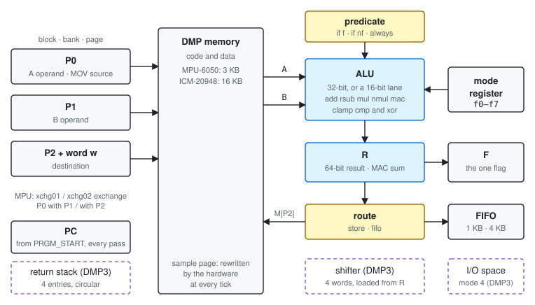
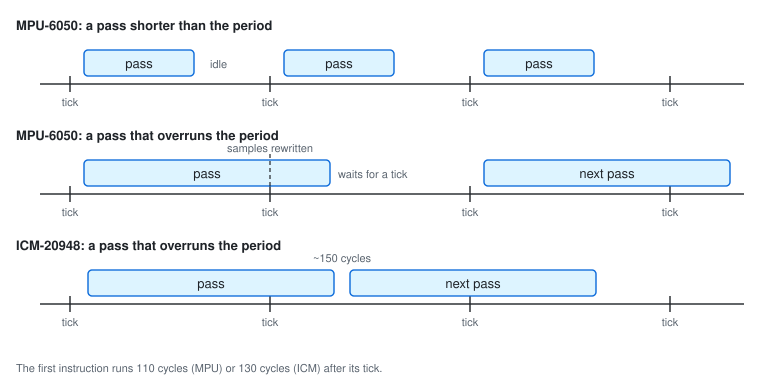

# 1. Architectural Overview

## 1.1 Introduction

The Digital Motion Processor (DMP) is a small processor built into InvenSense motion sensors. It
runs a program from its own memory once for every sensor sample, computes on that sample, and
leaves results in its memory and in the sensor's FIFO for the host to read.

Two cores are described in this manual:

| Core | Parts | Notes |
|---|---|---|
| DMP | MPU-6050, MPU-6500, MPU-9150, MPU-9250 | Measured on an MPU-6050. |
| DMP3 | ICM-20948 | The same instruction set, with a larger memory, absolute jumps, calls, a shifter and a register I/O space. |

Where the cores differ, the text says so: "MPU-6050" or "MPU" for the first core, "ICM-20948",
"ICM" or "DMP3" for the second.

**Features of both cores:**

- A 32-bit ALU that adds, subtracts, multiplies, multiply-accumulates, clamps, tests signs, ANDs
  and XORs, on whole words or on 16-bit lanes.
- A 64-bit result register R that holds every arithmetic result, accumulates products exactly,
  and is what `test` examines.
- No general-purpose registers. Every operand is a word in memory, named by one of three
  pointers.
- One flag, F: the sign of the exact result, or "the result is zero" after `test`.
- Sticky predicates that make any run of instructions conditional.
- Results routed either to memory or to the output FIFO.
- A whole number of clock cycles per instruction. On the parts measured the clock is 8.199 MHz
  (MPU-6050) and 20.975 MHz (ICM-20948).

**The two cores compared:**

| | MPU-6050 | ICM-20948 (DMP3) |
|---|---|---|
| DMP memory | 3 KB | 16 KB, of which 4 KB is the FIFO |
| Data a pointer reaches | 3 KB, through 3 blocks | 4 KB, through 4 blocks |
| Branch | relative, −32 to +31 bytes | absolute jump, 14-bit address |
| Subroutines | none | call / ret, 4-entry circular return stack |
| Shifter | none | 4 words, `shl` / `sar` |
| Immediate compare | none | `cmp.eq` / `gt` / `lt` / `ne` against 0–63 |
| Register I/O | none | page loads in mode 4 |
| Pointer exchange | `xchg01`, `xchg02` | none |
| Pass start after an overrun | the next sample tick | at once |
| Interrupt instruction | `int` (0xFE), `int.f4` | `int` (0xE2) |

## 1.2 Programmer's Model

*Figure 1-1. The DMP programmer's model. Dashed: DMP3 only.*

An instruction runs as follows:
1. P0 and P1 name the two operand words A and B.
2. The mode register selects the operation set (Table 3-2).
3. The ALU computes the result into R and sets F.
4. The route latch sends the result either to memory at P2 or to the FIFO.
5. A predicate, when armed and false, skips instructions instead of running them.

DMP3 adds three units:
- a four-entry return stack;
- a four-word shifter, loaded from R;
- the register I/O space that page loads reach in mode 4.

## 1.3 Machine State

| State | Width | Set by | After DMP_RST | Into the next pass, MPU-6050 | Into the next pass, ICM-20948 |
|---|---|---|---|---|---|
| PC | 16 bits | the entry point, `branch`, `jump`, `call`, `ret` | PRGM_START | PRGM_START | PRGM_START |
| P0, P1, P2 | block 2 + bank 2 + page 4 bits each | `pNblk`, `pNbank`, `pNpage` | 0x000 | kept | 0x0000 |
| P2.w | 2 bits | `p2page` (to 0), advancing forms, `p2inc2` | 0 | kept | 0 |
| Mode register | 3 bits | `fmode`, every F4 byte | 32-bit (`fmode 1`) | kept | kept |
| Route | 1 bit | `store`, `fifo` | RAM | kept | kept |
| F | 1 bit | arithmetic, `clamp`, `cmp`, `test`, `cmp.cond` | 0 | kept | kept |
| R | 64 bits | arithmetic, `clamp`, INC, DEC; DMP3 `load`, `shl`, `sar` | 0 | kept | kept |
| Predicate | armed / not, and its sense | `always`, `if f`, `if nf` | — | — | — |
| Exchanges (MPU) | two toggles | `xchg01`, `xchg02` | off | off | — |
| MOV substitution (DMP3) | toggle | `movz` | off | — | — |
| Shifter (DMP3) | 4 words | every op that writes R, `load k` | empty: a shift stores 0 | — | — |
| Return stack (DMP3) | 4 addresses and a pointer | `call`, `ret` | — | — | kept |

A dash means the state is not specified.

**Start every pass by setting what it uses:** `fmode`, `always`, the route, and the pointers. On
the ICM-20948 the pointers are 0 at the start of every pass. R, F, the mode and the route carry over
on both cores, and on the MPU-6050 so do the pointers.

## 1.4 Execution Model

*Figure 1-2. When a pass runs*

- **One pass per sample.** The host sets the sample rate. At each sample tick the hardware writes
  the sample page, and the DMP starts at the entry point (PRGM_START) 110 cycles later on the
  MPU-6050, 130 cycles later on the ICM-20948.
- **A pass runs until `end`.** Nothing preempts it. There is no interrupt input, no vector, and no
  restart on the next tick: a pass that never reaches `end` serves no further samples until the
  host resets the DMP.
- **Overruns.** A pass longer than the sample period delays the next pass:
  - MPU-6050: the next pass starts at the first tick after `end`. The pass rate falls to the sample
    rate divided by a whole number.
  - ICM-20948: if a tick has arrived, the next pass starts about 150 cycles after `end`. The pass
    rate is one over the pass time.
- **Samples during a pass.** The hardware rewrites the sample page at every tick, even under a
  running pass. On the MPU-6050 each such write stalls the pass by 14 to 28 cycles; on the
  ICM-20948 it costs nothing.
- **Stopping.** Clearing DMP_EN stops new passes, but a running pass runs on to its `end`. DMP_RST
  stops it (Chapter 7).

Code runs straight through memory from the entry point. Branches, jumps, calls and returns are
the only changes of flow.

## 1.5 Interrupts

The DMP takes no interrupts. It raises one, to tell the host that results are ready:

| Core | Instruction | Signal |
|---|---|---|
| MPU-6050 | `int` (0xFE), `int.f4 n` (0xF4 0x41–0x7F) | DMP_INT: `INT_STATUS` bit 1, and the INT pin if enabled in `INT_ENABLE` |
| ICM-20948 | `int` (0xE2) | DMP_INT1: `INT_STATUS` bit 1, and INT1 if enabled |

An `int` under a predicate raises the interrupt only when the predicate holds.

## 1.6 What the DMP Does Not Have

- General-purpose registers. Every operand is a memory word.
- Indexed or indirect addressing. Every address is fixed in the code.
- Immediate operands for arithmetic. Constants are words in data memory.
- Divide, square root, OR and NOT. Chapter 9 builds them from the instructions that exist.
- On the MPU-6050: a shift, a jump beyond 32 bytes, subroutines, a stack.
- Saturating arithmetic. Results wrap; CLAMP limits a value explicitly.
- Any way to read the program counter, the clock or a sample counter.
