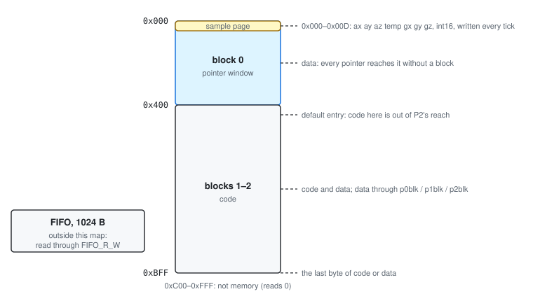
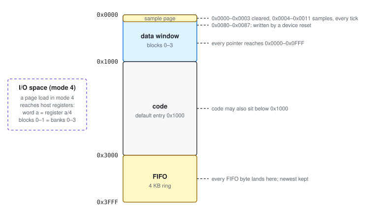
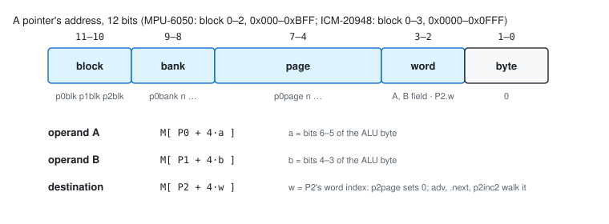
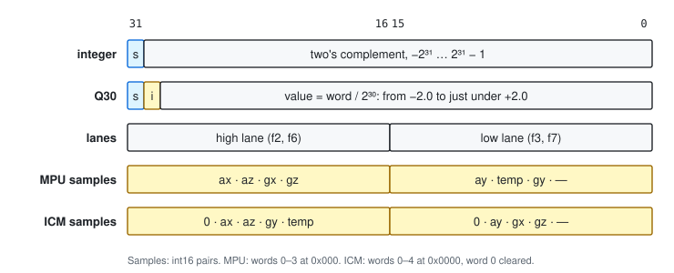

# 2. Memory Organization and Data Types

## 2.1 One Memory for Code and Data

The DMP has a single memory. Code and data share it, and the program can store over its own code.
There is no ROM or flash: the host writes the program and its data before it starts the DMP
(Chapter 7).

- **Volatility.** The memory keeps its contents across a device reset (`PWR_MGMT_1` = 0x80) and
  across DMP_RST, and loses them at power-off. On the ICM-20948 a device reset writes 8 bytes of
  part-specific data at 0x0080–0x0087, so load the program after the reset.
- **Byte order.** Big-endian: the byte at the lowest address is the most significant.
- **Words.** Every arithmetic operand is a 32-bit word on a 4-byte boundary.

| | MPU-6050 | ICM-20948 |
|---|---|---|
| DMP memory | 3 KB, 0x000–0xBFF | 16 KB, 0x0000–0x3FFF |
| reachable by a pointer | all of it, through the block field | 0x0000–0x0FFF |
| FIFO | 1024 B, outside DMP memory | 4096 B, DMP memory 0x3000–0x3FFF |
| sample page | 0x000–0x00D | 0x0000–0x0011 |
| default entry point | 0x400 | 0x1000 |

## 2.2 MPU-6050 Memory Map



*Figure 2-1. MPU-6050 DMP memory map*

| Address | Contents |
|---|---|
| 0x000–0x00D | The sample page (§2.4), rewritten by the hardware at every sample tick. |
| 0x00E–0x3FF | Data. Every pointer reaches block 0 without the block field. |
| 0x400–0xBFF | Code, from the default entry point 0x400. Pointers reach this region only through the block field, so stores cannot overwrite code placed here by accident. |
| 0xC00–0xFFF | Not memory. Host reads return 0. |

Code may start anywhere in 0x00E–0xBFF. Execution runs straight through the address space from
the entry point, and the last byte of code may be 0xBFF. A program must reach `end` before 0xBFF.

## 2.3 ICM-20948 Memory Map



*Figure 2-2. ICM-20948 DMP memory map*

| Address | Contents |
|---|---|
| 0x0000–0x0003 | Cleared by the hardware at every sample tick. |
| 0x0004–0x0011 | The sample page (§2.4), rewritten at every sample tick. |
| 0x0080–0x0087 | Written with part data by a device reset. Ordinary memory otherwise. |
| 0x0000–0x0FFF | The data window: every pointer reaches it (blocks 0–3). |
| 0x1000–0x2FFF | Code, from the default entry point 0x1000. Code may also be placed in the data window. |
| 0x3000–0x3FFF | The FIFO, a 4 KB ring. Every byte the program emits lands here, and the host reads it through `FIFO_R_W`. Code and data must end below 0x3000. |

**The I/O space.** In mode 4 (§3.8), a page load (`p0page`, `p1page`, `p2page`) points the pointer
into the host's register file instead of memory. Word *a* of that space is register *a* / 4. The
four register banks lie end to end, 128 registers each, so blocks 0–1 cover banks 0–3, and blocks
2–3 reach nothing.

- A read returns the register in the low byte of the word.
- A store writes the register.
- Configuration and trim registers read back. Live sensor outputs, `PWR_MGMT_1`, `INT_ENABLE` and a
  few others read 0.

A MOV whose pointers were loaded before mode 4 is an ordinary memory MOV. The sample page is
memory, not I/O.

## 2.4 The Sample Page

Before each pass, and at every sample tick, the hardware writes the latest sensor sample into the
sample page. Each value is a 16-bit two's-complement count, big-endian, as the host's own output
registers hold it.

| Offset | MPU-6050 (0x000) | ICM-20948 (0x0000) |
|---|---|---|
| +0x00 | accel X | 0 (cleared) |
| +0x02 | accel Y | 0 (cleared) |
| +0x04 | accel Z | accel X |
| +0x06 | temperature | accel Y |
| +0x08 | gyro X | accel Z |
| +0x0A | gyro Y | gyro X |
| +0x0C | gyro Z | gyro Y |
| +0x0E | not written | gyro Z |
| +0x10 | — | temperature |

- **FSYNC.** With `EXT_SYNC_SET` = 1 (MPU `CONFIG`, ICM `FSYNC_CONFIG`), bit 0 of the temperature
  is the level of the FSYNC pin: address 0x007 on the MPU-6050, 0x0011 on the ICM-20948.
- **Mid-pass writes.** The hardware rewrites the sample page at every tick, even while a pass is
  running. A pass that lasts longer than one sample period sees newer samples part-way through.
- **Word layout.** The sample page holds two samples per word: the MPU's word 0 is accel X in the
  high half and accel Y in the low half.

## 2.5 Pointers and Address Formation

Three pointers name every memory operand.

| Pointer | Names |
|---|---|
| P0 | the A operand of an ALU instruction, and the source of MOV and MOVX |
| P1 | the B operand of an ALU instruction |
| P2 | the destination of every store, with a 2-bit word index P2.w |



*Figure 2-3. How an operand address is formed*

Each pointer holds three fields, each set by its own instruction:

```
    address = block * 1024 + bank * 256 + page * 16        block 0-3, bank 0-3, page 0-15
```

| Field | Set by | Notes |
|---|---|---|
| block | `p0blk`, `p1blk`, `p2blk` | Adds one block. MPU-6050: modulo 3, kept from pass to pass until DMP_RST. ICM-20948: modulo 4, cleared at the start of every pass. |
| bank | `p0bank n`, `p1bank n`, `p2bank n` | |
| page | `p0page n`, `p1page n`, `p2page n` | `p2page` also sets P2.w to 0. |

A page is four words, and the word within the page comes from a different place for each role:

| Operand | Address |
|---|---|
| A | M[P0 + 4·a], with *a* from bits 6–5 of the ALU byte |
| B | M[P1 + 4·b], with *b* from bits 4–3 of the ALU byte |
| MOV source | M[P0 + 4·k], with *k* from bits 2–1 of the MOV byte |
| destination | M[P2 + 4·P2.w] |

**The destination word index.** P2.w is a 2-bit counter that wraps from 3 to 0:
- `p2page` sets it to 0;
- the advancing forms (`add A,B,inc`, `mov k,inc`, `clr.next`, `inc.next`, `dec.next`,
  `lo.next`, a shift with `adv`) add 1 before they store;
- `p2inc2` adds 2.

The operand words are addressed directly; the destination is walked.

**Persistence.** Pointer loads are sticky. On the MPU-6050 every pointer field, and P2.w, carries
from one pass to the next. On the ICM-20948 all three pointers and P2.w restart at 0x0000, word 0,
at the start of every pass. After DMP_RST all three pointers are 0x000, word 0, on both cores.

**On the MPU-6050, moving the destination clears R.** Every instruction that changes P2 or P2.w on
the MPU-6050 also sets the result register R to 0: a P2 page or bank load, `p2inc2`, `clr.next`,
and every advancing form (§3.2).

There is no indexed or indirect addressing. Every address a program uses is fixed in its code.

## 2.6 Addressing Modes

| Mode | Instructions | Operand |
|---|---|---|
| Word-indexed | ALU operand A, MOV/MOVX source | M[P0 + 4·field] |
| Word-indexed | ALU operand B | M[P1 + 4·field] |
| Walked destination | every store | M[P2 + 4·P2.w], through the route |
| Route | every store | memory at P2 (`store`) or the FIFO (`fifo`) |
| Immediate | `branch`, `jump`, `call`, `cmp.eq`/`gt`/`lt`/`ne`, `shl`, `sar` | a displacement, a 14-bit address, a 6-bit constant, a shift count |
| Register I/O (DMP3) | page loads in mode 4 | host register *a* / 4 |

The ALU has no other immediate operand. Every constant is a word in data memory (§2.7).

## 2.7 Data Types



*Figure 2-4. Word formats*

### Integer and Q30

A word is 32 bits, big-endian. The same bits can be read in two ways:

| Reading | Value | Range | Resolution |
|---|---|---|---|
| Integer | the two's-complement word | −2³¹ to 2³¹ − 1 | 1 |
| Q30 fixed point | word / 2³⁰ | −2.0 to 2.0 − 2⁻³⁰ | 2⁻³⁰ ≈ 9.3 × 10⁻¹⁰ |

| Word | Integer | Q30 |
|---|---:|---:|
| 0x40000000 | 1073741824 | +1.0 |
| 0x60000000 | 1610612736 | +1.5 |
| 0x20000000 | 536870912 | +0.5 |
| 0x00000001 | 1 | 2⁻³⁰ |
| 0xE0000000 | −536870912 | −0.5 |
| 0x80000000 | −2147483648 | −2.0 |

The ALU does not know which reading a program intends:
- **Same bits either way:** ADD, RSUB, INC, DEC, CLR, MOV, MOVX, AND, XOR, CLAMP and every
  comparison. A program may use any word as a counter, a set of flags or a fraction.
- **The one exception is multiplication.** MUL, NMUL and MAC keep the product's high bits:
  ⌊A·B / 2³⁰⌋. That is the right result for two Q30 operands, and for two integers it is their
  product divided by 2³⁰ (3 × 5 gives 0). §3.2 lists the ways to multiply integers.

**Results wrap.** A result that does not fit in the word (or the lane) is stored modulo 2³² (or
2¹⁶); nothing saturates. The flag F still sees the exact result: in Q30, 1.0 + 1.5 stores −1.5 and
leaves F clear.

### Lanes

Under the lane modes the ALU computes on one 16-bit half of each word (Figure 2-4):

| Mode | Lane | Operands | Result |
|---|---|---|---|
| `fmode 2`, `fmode 6` | high | the high half-words, in place (the low halves read as 0) | writes the high half; the low half is unchanged |
| `fmode 3`, `fmode 7` | low | the low half-words, sign-extended, as integers | writes the low half; the high half is unchanged |

A lane result routed to the FIFO is 2 bytes. There is no carry between the halves. The lanes are
true 16-bit integer ALUs for add, subtract, increment, decrement, clear, AND, XOR and CLAMP.

### Samples as values

A sample is a 16-bit count in one half of a word (§2.4). Two conversions are common:
- Moved into the high half of a cleared word (`clr`, then `mov` or `movx` under `fmode 2`), a
  count *c* reads in Q30 as *c* / 16384.
- Kept in the low half, it is an integer under `fmode 3`.

### Constants

There is no constant memory and no immediate data operand. The host writes every constant the
program reads, including the 0.0 that a copy or an emit adds, into data memory before it starts
the DMP. In assembly, `.dw` places them (Chapter 8):

```asm mpu6050
        .chip   mpu6050
        .org    0x100
k:      .dw     0.5q, 1.5q, 100i, 0x7fff     ; Q30 0.5, Q30 1.5, the integer 100, a hex word
        .org    0x400
        fmode   1
        always
        end
        ; expect 0x100 = 20000000, 60000000, 00000064, 00007fff
```

## 2.8 Allocating Storage

There is no allocator. A program owns every byte outside the sample page, the FIFO and its own
code.

1. **Group data in pages of four words.** An ALU instruction reaches all four words of each operand
   page without a pointer reload, and the destination walks the four words of its page.
2. **Recommended layout.**
   - MPU-6050: data from 0x010 to 0x3FF, code from 0x400.
   - ICM-20948: data from 0x0010 to 0x0FFF, code from 0x1000, everything below 0x3000.
3. **Data beyond block 0** (MPU 0x400–0xBFF, ICM blocks 1–3) is reached with `p0blk`, `p1blk` or
   `p2blk`. On the MPU-6050 the block field persists across passes, so a pass that moves a block
   must move it back: three `pNblk` in all.
4. **Initial values.** The host writes initial values after the device reset and before it enables
   the DMP.
