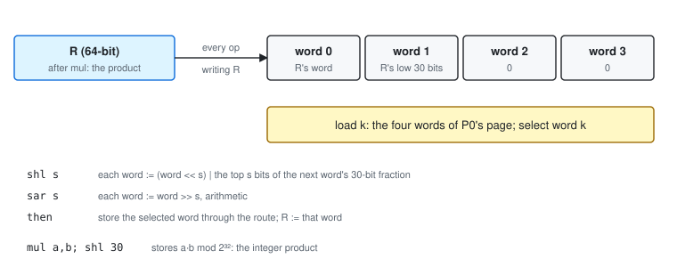
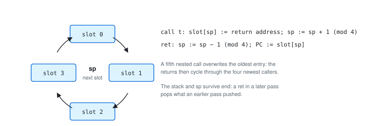
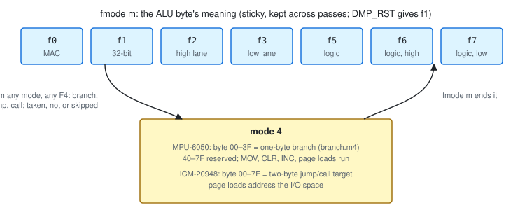

# 3. Programmer's Guide

This chapter describes the instruction set by class. Chapter 4 summarizes every instruction in
tables, and Chapter 5 defines each one in full.

Unless an example is a whole program, it runs in the *definitions harness*. On entry, the harness
leaves the machine as follows:

| State | Harness value |
|---|---|
| P0 | 0x100 |
| P1 | 0x110 |
| P2 | 0x120, word 0 |
| mode | `fmode 1` |
| predicate | none armed |
| route | RAM (`store`) |

The harness ends the example with `end`. The `; given` and `; expect` comments are machine-checked
(Chapter 8).

## 3.1 Instruction Formats

Almost every instruction is one byte. The two exceptions are the F4 forms (a branch, jump or
call target, or an interrupt code) and, on DMP3, the FC compare and the FD shift.

*Table 3-1. Instruction formats*

<!-- BEGIN generated:formats -->
<table>
<tr><th>Class</th><th>Format</th><th>7</th><th>6</th><th>5</th><th>4</th><th>3</th><th>2</th><th>1</th><th>0</th><th>Hex</th><th>Instructions</th></tr>
<tr><td rowspan="3">Arithmetic and logic</td><td>ALU</td><td>0</td><td colspan="2">A</td><td colspan="2">B</td><td>adv</td><td colspan="2">op</td><td>00–7F</td><td>under f1–f3: add rsub mul nmul · f0: mac macn · f5–f7: clamp cmp and xor</td></tr>
<tr><td>one-byte branch (MPU, mode 4)</td><td>0</td><td>0</td><td colspan="6">d</td><td>00–3F</td><td>branch.m4: to its own address + 1 + d (d signed)</td></tr>
<tr><td>branch target (DMP3, mode 4)</td><td>0</td><td>call</td><td colspan="6">t</td><td>00–7F</td><td>the high byte of a jump.m4 (call = 0) or call.m4 (call = 1); the next byte is t[7:0]</td></tr>
<tr><td rowspan="3">Pointer control</td><td>page</td><td>1</td><td>0</td><td colspan="2">P</td><td colspan="4">page</td><td>80–AF</td><td>p0page p1page p2page (P = 0, 1, 2)</td></tr>
<tr><td>bank</td><td>1</td><td>0</td><td>1</td><td>1</td><td colspan="2">P</td><td colspan="2">bank</td><td>B0–BB</td><td>p0bank p1bank p2bank (P = 0, 1, 2)</td></tr>
<tr><td>block</td><td>1</td><td>0</td><td>1</td><td>1</td><td>1</td><td>1</td><td colspan="2">P</td><td>BC–BF</td><td>p0blk p1blk p2blk (P = 0, 1, 2); P = 3: DMP3 movz, reserved on the MPU</td></tr>
<tr><td rowspan="1">Data transfer</td><td>move</td><td>1</td><td>1</td><td>0</td><td>0</td><td>x</td><td colspan="2">k</td><td>adv</td><td>C0–CF</td><td>mov (x = 0), movx (x = 1): from P0's word k</td></tr>
<tr><td rowspan="2">Control</td><td>D group</td><td>1</td><td>1</td><td>0</td><td>1</td><td colspan="4">fn</td><td>D0–DF</td><td>p2inc2 test · MPU: clear aliases d2–d7 · DMP3: lo lo.next load · always if store fifo clr clr.next</td></tr>
<tr><td>E group</td><td>1</td><td>1</td><td>1</td><td>0</td><td colspan="4">fn</td><td>E0–EF</td><td>MPU: clear aliases · DMP3: ret (E0), int (E2), clear alias (E7)</td></tr>
<tr><td rowspan="3">Mode and flow</td><td>mode</td><td>1</td><td>1</td><td>1</td><td>1</td><td>0</td><td colspan="3">m</td><td>F0–F7</td><td>fmode m (m ≠ 4) · F4 enters mode 4 and is the branch / jump / call prefix</td></tr>
<tr><td>increment</td><td>1</td><td>1</td><td>1</td><td>1</td><td>1</td><td>0</td><td>adv</td><td>dec</td><td>F8–FB</td><td>inc dec inc.next dec.next</td></tr>
<tr><td>system</td><td>1</td><td>1</td><td>1</td><td>1</td><td>1</td><td>1</td><td colspan="2">fn</td><td>FC–FF</td><td>MPU: xchg01 xchg02 int · DMP3: the cmp.cond and shift prefixes · end (FF) on both</td></tr>
</table>
<!-- END generated:formats -->

*Table 3-1a. Multi-byte forms*

<!-- BEGIN generated:formats-multibyte -->
<table>
<tr><th>Core</th><th>Instruction</th><th>Byte</th><th>7</th><th>6</th><th>5</th><th>4</th><th>3</th><th>2</th><th>1</th><th>0</th><th>Hex</th><th>Meaning</th></tr>
<tr><td rowspan="2">MPU-6050</td><td rowspan="2">branch</td><td>1</td><td>1</td><td>1</td><td>1</td><td>1</td><td>0</td><td>1</td><td>0</td><td>0</td><td rowspan="2">F4 00–3F</td><td rowspan="2">to the F4's address + 2 + d, d a signed 6-bit displacement</td></tr>
<tr><td>2</td><td>0</td><td>0</td><td colspan="6">d</td></tr>
<tr><td rowspan="2">MPU-6050</td><td rowspan="2">int.f4</td><td>1</td><td>1</td><td>1</td><td>1</td><td>1</td><td>0</td><td>1</td><td>0</td><td>0</td><td rowspan="2">F4 41–7F</td><td rowspan="2">n with a non-zero low five bits: raise DMP_INT; F4 40: nothing (nop.f440); F4 60: reserved</td></tr>
<tr><td>2</td><td>0</td><td>1</td><td colspan="6">n</td></tr>
<tr><td rowspan="1">MPU-6050</td><td rowspan="1">nop.f4</td><td>1</td><td>1</td><td>1</td><td>1</td><td>1</td><td>0</td><td>1</td><td>0</td><td>0</td><td rowspan="1">F4 + byte ≥ 80</td><td rowspan="1">one byte: enters mode 4; the next byte is the next instruction</td></tr>
<tr><td rowspan="3">ICM-20948</td><td rowspan="3">jump / call</td><td>1</td><td>1</td><td>1</td><td>1</td><td>1</td><td>0</td><td>1</td><td>0</td><td>0</td><td rowspan="3">F4 00–7F xx</td><td rowspan="3">to t, absolute; call = 1 pushes the address after the instruction</td></tr>
<tr><td>2</td><td>0</td><td>call</td><td colspan="6">t13–t8</td></tr>
<tr><td>3</td><td colspan="8">t7–t0</td></tr>
<tr><td rowspan="1">ICM-20948</td><td rowspan="1">mode4</td><td>1</td><td>1</td><td>1</td><td>1</td><td>1</td><td>0</td><td>1</td><td>0</td><td>0</td><td rowspan="1">F4 + byte ≥ 80</td><td rowspan="1">one byte: enters mode 4</td></tr>
<tr><td rowspan="3">ICM-20948</td><td rowspan="3">cmp.cond</td><td>1</td><td>1</td><td>1</td><td>1</td><td>1</td><td>1</td><td>1</td><td>0</td><td>0</td><td rowspan="3">FC C0–C3 xx</td><td rowspan="3">F := (P1 word k & 0x3F) cond t, cond c = 0 ==, 1 >, 2 <, 3 ≠</td></tr>
<tr><td>2</td><td>1</td><td>1</td><td>0</td><td>0</td><td>0</td><td>0</td><td colspan="2">k</td></tr>
<tr><td>3</td><td colspan="6">t</td><td colspan="2">c</td></tr>
<tr><td rowspan="2">ICM-20948</td><td rowspan="2">shl / sar</td><td>1</td><td>1</td><td>1</td><td>1</td><td>1</td><td>1</td><td>1</td><td>0</td><td>1</td><td rowspan="2">FD 01–7F</td><td rowspan="2">r = 0: shl s (s = 1–31); r = 1: sar 32 − s (s = 0 gives sar 32)</td></tr>
<tr><td>2</td><td>0</td><td>adv</td><td>r</td><td colspan="5">s</td></tr>
</table>
<!-- END generated:formats-multibyte -->

### The ALU byte

A byte below 0x80 is an ALU instruction, except in mode 4 (§3.8). Its fields:

- **A** (bits 6–5) selects word A of P0's page.
- **B** (bits 4–3) selects word B of P1's page.
- **adv** (bit 2) advances P2.w before the store.
- **op** (bits 1–0) selects the operation. The mode register says what the four operations are:

*Table 3-2. The ALU byte's operation, by mode*

<!-- BEGIN generated:opmap-alu -->
| op field | `fmode 0` | `fmode 1`–`3` | `fmode 5`–`7` |
|---|---|---|---|
| 0 (`00`) | mac | add | clamp |
| 1 (`01`) | macn | rsub | cmp |
| 2 (`10`) | mac.m | mul | and |
| 3 (`11`) | macn.m | nmul | xor |
<!-- END generated:opmap-alu -->

Under `fmode 0`, op 2 and op 3 repeat op 0 and op 1. The assembler names them `mac.m` and
`macn.m`.

```text
    0x2C = 0 01 01 1 00   A = 1, B = 1, adv, op 0   under f1: add 1,1,inc
                                                     P2.w += 1;  M[P2] := M[P0+4] + M[P1+4]
    0x69 = 0 11 01 0 01   A = 3, B = 1, op 1        under f1: rsub 3,1
                                                     M[P2] := M[P1+4] - M[P0+12]
```

## 3.2 Arithmetic

| Instruction | Result r | Stored |
|---|---|---|
| `add A,B` | A + B | r, wrapped |
| `rsub A,B` | B − A | r, wrapped |
| `mul A,B` | ⌊A·B / 2³⁰⌋ | r, wrapped |
| `nmul A,B` | ⌊−A·B / 2³⁰⌋ | r, wrapped |

- **F** is the sign of the exact result, before it wraps.
- **R**, the result register, takes the exact result. After `mul` and `nmul` it holds the whole
  64-bit product.
- **The store** goes through the route: to M[P2 + 4·P2.w] in RAM, or to the FIFO.

```asm both
        ; given 0x100 = 1.0q
        ; given 0x110 = 1.5q
        add     0,0             ; 1.0 + 1.5 = 2.5 wraps to -1.5
        ; expect 0x120 = -1.5q
        ; expect F = 0
```

```asm both
        ; given 0x100 = 7i
        ; given 0x110 = 100i
        rsub    0,0             ; 100 - 7, as integers
        ; expect 0x120 = 93i
```

**RSUB and −2.0.** RSUB computes B + (−A) with −A wrapped to the word, or to the lane under a lane
mode. For A = 0x80000000 (−2.0 in Q30), −A wraps back to 0x80000000. RSUB then adds, and F is the
sign of that sum. Every other A gives the true sign of B − A.

### Integers and multiplication

ADD, RSUB, INC and DEC compute the same bits whether the words are integers or Q30 (§2.7).
Multiplication keeps the high bits, ⌊A·B / 2³⁰⌋, which is right for two Q30 operands:

```asm both
        ; given 0x100 = 0.5q
        ; given 0x110 = -0.25q
        mul     0,0
        ; expect 0x120 = -0.125q
```

For integers, use one of the following:

| To compute | Use |
|---|---|
| x · K, K a constant | doublings and additions (Horner's rule): 10x = 2(2(2x) + x) |
| ⌊x / 2^k⌋ | `mul` by the word 2^(30−k): an exact arithmetic right shift |
| x · y on DMP3 | `mul`, then `shl 30` (stores x·y mod 2³²) |
| x · y on the MPU-6050 | a shift-and-add loop (§9.9) |

```asm both
        ; x * 10 by doublings: P0, P1 and P2 on one page {x, t}
        ; given 0x100 = 37i
        p1page  0
        p2page  0
        add     0,0,inc         ; t := 2x
        add     1,1             ; t := 4x
        add     1,0             ; t := 5x
        add     1,1             ; t := 10x
        ; expect 0x104 = 370i
```

```asm both
        ; floor(x / 2) as a multiplication by 2^29
        ; given 0x100 = -7i
        ; given 0x110 = 20000000
        mul     0,0
        ; expect 0x120 = -4i
```

```asm icm20948
        ; DMP3: the integer product in two instructions
        ; given 0x100 = 1234i
        ; given 0x110 = -567i
        mul     0,0             ; R := the whole product; the shifter is loaded from R
        shl     30              ; store (R's word << 30) | R's low 30 bits
        ; expect 0x120 = -699678i
```

### Multiply-accumulate

Under `fmode 0` an ALU byte adds its product to R (`mac`) or subtracts it (`macn`), then stores
⌊R / 2³⁰⌋.
- **Precision.** R is 64 bits wide and holds Q60 values in [−8, 8). The products are summed
  exactly and floored only when stored.
- **Overflow.** R wraps modulo 2⁶⁴, and the stored word wraps modulo 2³².
- **F** is the sign bit of R.

What starts a sum:

| Event | MPU-6050 | ICM-20948 |
|---|---|---|
| A non-MAC arithmetic op (`add`, `mul`, ...) | replaces R | replaces R |
| A P2 move: page or bank load, `p2inc2`, `clr.next`, any advancing form | R := 0 | R kept |
| A MAC op with `adv` | R := 0, then ± A·B | R := ± A·B |
| The end of a pass | R kept | R kept |

The safe way to begin a sum on either core is to compute its first term with `mul`. MUL replaces R
with the whole product, and the following MACs add to it exactly:

```asm both
        ; a three-term dot product: 0.5*0.5 + 0.25*0.5 + 1.0*0.25
        ; given 0x100 = 0.5q, 0.25q, 1.0q
        ; given 0x110 = 0.5q, 0.5q, 0.25q
        mul     0,0             ; R := 0.25 (fmode 1)
        fmode   0
        mac     1,1             ; R := 0.375
        mac     2,2             ; R := 0.625; stored at 0x120
        ; expect 0x120 = 0.625q
```

### Increment and decrement

`inc` and `dec` add or subtract one LSB of the lane to the destination word M[P2]:
- the low half-word under `fmode 3` and `fmode 7`;
- the high half-word under `fmode 2` and `fmode 6`;
- otherwise the whole word.

`inc.next` and `dec.next` advance P2.w first. F is the sign of the exact result, and R takes the
result.

```asm both
        ; given 0x120 = 41i, 1234ffff
        inc                     ; a counter
        fmode   3
        inc.next                ; the low lane wraps; no carry into the high half
        ; expect 0x120 = 42i, 12340000
```

Where the result goes depends on the route:

| Route | MPU-6050 | ICM-20948 |
|---|---|---|
| RAM (`store`) | M[P2] := the result | M[P2] := the result |
| FIFO (`fifo`) | emits M[P2] ± 1 as a new FIFO item, of the lane's width; RAM is unchanged | changes the last word already in the FIFO; under a lane mode the result is undefined |

### Lanes

```asm both
        ; given 0x100 = 00010005
        ; given 0x110 = 0002fffe
        fmode   3
        add     0,0             ; low lanes: 5 + (-2) = 3; the high half of 0x120 is kept
        fmode   2
        add     0,0,inc         ; high lanes: 1 + 2 = 3, into word 1's high half
        ; expect 0x120 = 00000003, 00030000
```

### The product's low word and the shifter (DMP3)

**`lo`** stores R's low 30 bits, sign-extended from bit 29. After a `mul`, that is the low part
of the product; after a MAC run, the low part of the sum. `lo.next` advances P2.w first.

```asm icm20948
        ; given 0x100 = 01234567
        ; given 0x110 = 89abcdef
        mul     0,0             ; the high part:  fde578db
        lo.next                 ; the low part:   094e4629
        ; expect 0x120 = fde578db, 094e4629
```



*Figure 3-3. The DMP3 shifter*

The shifter is a four-word register.
- **Loaded from R.** Every instruction that writes R loads it: word 0 is R's word, word 1 is R's
  low 30 bits, and words 2 and 3 are 0.
- **`load k`** fills it from the four words of P0's page instead, and selects word *k* for
  storing.
- **`shl s`** shifts every word left by *s*, pulling in the top *s* bits of the next word's 30-bit
  fraction.
- **`sar s`** shifts every word right, arithmetically.

Both shifts then store the selected word through the route, and R takes that word.

```asm icm20948
        ; given 0x100 = -7i, 0.5q
        load    0
        sar     1               ; -7 >> 1 = -4
        load    0
        shl     1,adv           ; (-7 << 1) | the top bit of word 1's fraction (0.5) = -13
        ; expect 0x120 = -4i, -13i
```

## 3.3 Logic and Compare

Under `fmode 5`, `fmode 6` and `fmode 7`, the ALU byte is a logic operation, on the whole word or
on one lane:

| Instruction | Result | F | R |
|---|---|---|---|
| `clamp A,B` | A clamped to [−B, B]: A ≥ 0 ? min(A, B) : max(A, −B), wrapped | A was clamped | D = (A ≥ 0 ? B − A : A + B) |
| `cmp A,B` | nothing stored | A < 0 ≤ B | unchanged |
| `and A,B` | A AND B | unchanged | unchanged |
| `xor A,B` | A XOR B | unchanged | unchanged |

```asm both
        ; given 0x100 = 1.5q, -1.5q
        ; given 0x110 = 1.0q
        fmode   5
        clamp   0,0             ; 1.5 -> 1.0
        clamp   1,0,inc         ; -1.5 -> -1.0, into word 1
        ; expect 0x120 = 1.0q, -1.0q
        ; expect F = 1
```

- **CLAMP and `test`.** CLAMP leaves its internal compare D in R, so a `test` after it asks
  whether A sat exactly on its bound.
- **`cmp` is not a compare.** It is a sign test: F is set only when A is negative and B is not.
- **OR and NOT.** There is no OR or NOT. a OR b = (a XOR b) XOR (a AND b), and NOT a = a XOR −1.

### `test`

`test` sets F := (R's word = 0). Under a lane mode it looks only at that lane, the one in force
when `test` runs. R holds the last arithmetic result, so `test` after an `rsub` tells whether the
operands were equal. Two things to keep in mind:
- AND, XOR and the sign test do not write R. A `test` after them repeats the earlier answer.
- On the MPU-6050 a P2 move between the arithmetic and the `test` zeroes R.

### Comparisons

There is no compare instruction. Subtract with `rsub` into a scratch word and read F:

| Test | RSUB operands | Then |
|---|---|---|
| x > y | A = x, B = y (computes y − x) | `if f` |
| x ≤ y | A = x, B = y | `if nf` |
| x < y | A = y, B = x | `if f` |
| x ≥ y | A = y, B = x | `if nf` |
| x = y, x ≠ y | either order, then `test` | `if f`, `if nf` |

```asm both
        ; given 0x100 = 5i
        ; given 0x110 = 3i
        rsub    0,0             ; 3 - 5 < 0: F says x > y
        ; expect F = 1
```

F is the sign of the exact difference, so a comparison never overflows. The one exception is an A
operand of 0x80000000, which RSUB adds (§3.2). When x can be 0x80000000, first test for that value:
RSUB with A = 0x80000001 and B = x gives F = 1 exactly when x = 0x80000000. Chapter 9 shows the
guarded form.

### Immediate compare (DMP3)

`cmp.eq k,t`, `cmp.gt k,t`, `cmp.lt k,t` and `cmp.ne k,t` set F from the low 6 bits of P1's word
*k*, compared unsigned against the constant *t* (0–63).
- They store nothing, and they leave R unchanged.
- They set F even while a predicate is armed.
- They are three bytes and take no constant word from memory.

```asm icm20948
        ; given 0x110 = 10i
        cmp.eq  0,10
        ; expect F = 1
```

## 3.4 Data Transfer

| Instruction | Effect |
|---|---|
| `mov k` | P0's word *k*, through the route |
| `movx k` | P0's word *k* with its half-words exchanged, through the route |
| `clr` | 0, through the route, to the current word |
| `clr.next` | advance P2.w, then 0 |

MOV and MOVX respect the lane: under `fmode 2` only the high half is written, under `fmode 3` only
the low half, and a lane routed to the FIFO is 2 bytes. Neither one touches F or R.

```asm both
        ; given 0x100 = 12345678
        ; given 0x120 = c0ffee00, 00000005
        fmode   2
        movx    0               ; the source's low half into the destination's high half
        fmode   1
        p0page  2               ; P0 -> 0x120
        movx    1,inc           ; 00000005 -> 00050000, into word 1
        ; expect 0x120 = 5678ee00, 00050000
```

- **Emitting a value.** Set the route to the FIFO, then `mov` the word. An arithmetic op emits its
  result the same way.
- **Copying from P1's page.** MOV reads only P0, so add a zero word with `add`.
- **The clear aliases.** `clr` (0xDE) and `clr.next` (0xDF) are the clear instructions. The MPU-6050
  also clears on 0xD2–0xD7 and 0xE0–0xEF, and the ICM-20948 on 0xE7. Those aliases cost as much as
  an add.
- **`movz` (DMP3)** toggles a latch. While it is set, a MOV stores a value that depends on the
  FIFO instead of its source. That value is not reliable, so do not use `movz`.

```asm both
        ; given 0x100 = 0.25q
        fifo
        mov     0               ; emit one word
        ; expect fifo = 10000000
```

## 3.5 Pointer Control

| Instruction | Effect |
|---|---|
| `p0page n`, `p1page n`, `p2page n` | the pointer's page := *n*; `p2page` also sets P2.w := 0 |
| `p0bank n`, `p1bank n`, `p2bank n` | the pointer's bank := *n* |
| `p0blk`, `p1blk`, `p2blk` | the pointer's block += 1 (MPU modulo 3, DMP3 modulo 4) |
| `p2inc2` | P2.w += 2 |
| `xchg01` (MPU) | toggle: the A operand and MOV read through P1, the B operand through P0 |
| `xchg02` (MPU) | toggle: the A operand and MOV read through P2, and stores go to P0's page |

**Reaching a destination word.** From a fresh `p2page`:

| Word | How |
|---|---|
| 0 | store directly |
| 1 | an advancing form (`add A,B,inc`, `mov k,inc`, `inc.next`), or `clr.next` (which clears it) |
| 2 | `p2inc2`, or two advances |
| 3 | `p2inc2` and an advancing form |

**There is no NOP.** Every byte changes some state:

| Byte | What it changes |
|---|---|
| `p2page n` | P2 and P2.w; on the MPU-6050, also R |
| `fmode m` | the mode register |
| `always` | the predicate |
| `store`, `fifo` | the route |

Pad only with bytes whose effects are harmless at that point in the program.

The MPU-6050's exchanges last until the same instruction toggles them again, or until the end of
the pass. `xchg01` reverses a subtraction without reloading pointers: after it, `rsub A,B` computes
P0's word B minus P1's word A.

## 3.6 Routing and Predicates

**The route.**
- `store` sends every following result to memory at P2; `fifo` sends it to the FIFO.
- The route stays until the other instruction is executed, and carries over into the next pass.
- After DMP_RST it is RAM.

**Predicates.**
- `if f` arms a predicate that runs instructions only while F is set; `if nf` runs them only while F
  is clear. `if f.alt` (0xDB) behaves as `if f`.
- A predicate stays armed until the next `always`, `if f`, `if nf` or `if f.alt`.
- An instruction the predicate skips costs one cheap cycle count per byte (5 cycles on the
  MPU-6050, 4 on the ICM-20948).

The rules:

1. **Mode bytes always act.** `fmode` runs even under a false predicate, and so does every F4 byte
   (it enters mode 4, §3.8).
2. **F is frozen while a predicate is armed.** Instructions inside a predicated block cannot change
   the condition that governs it. `test` and the DMP3 `cmp.cond` are the exceptions: they set F
   even then.
3. **Close every conditional block with `always`.** Otherwise the predicate goes on skipping code,
   including `end`.

```asm both
        ; if x < 0 then count += 1
        ; given 0x100 = -5i, 0, 0
        ; given 0x124 = 7i
        add     0,2             ; scratch := x + 0; F := x < 0
        if      f
        inc.next                ; count += 1, at 0x124
        always
        ; expect 0x124 = 8i
```

## 3.7 Program Flow

### MPU-6050: the relative branch

`branch target` is two bytes: F4 and a signed 6-bit displacement *d*. It goes to the F4's address +
2 + *d*, so its reach is 31 bytes forward and 32 bytes back. Under `if f` or `if nf` it is
conditional; skipped, it costs two cheap bytes.

Every F4 leaves the machine in mode 4 (§3.8). In mode 4 a byte 0x00–0x3F is itself a one-byte
branch (`branch.m4`), to its own address + 1 + *d*. So at a branch target, and on the fall-through
after a branch, write `always` and a mode byte before the next ALU instruction.

```asm mpu6050
        ; skip a block when x < 0
        ; given 0x100 = -5i, 0, 0
        ; given 0x124 = 7i
        add     0,2             ; F := x < 0
        if      f
        branch  done
        always                  ; the fall-through: end the predicate
        fmode   1               ; and leave mode 4
        inc.next                ; skipped when x < 0
done:   always                  ; the target: the predicate is still armed
        fmode   1               ; and mode 4 is in force
        ; expect 0x124 = 7i
```

**Farther targets.** A target beyond reach needs a hop: an unconditional branch placed within
reach that goes the rest of the way. The straight path steps over the hop (§9.11).

The MPU-6050 has no call or return. Write subroutines inline.

### ICM-20948: jump, call and return

`jump target` and `call target` are three bytes: F4 and a 14-bit absolute address. `call` pushes
the address of the next instruction, and `ret` (0xE0) pops it.
- **Mode 4.** Every F4 leaves mode 4, as on the MPU-6050. In mode 4, any byte below 0x80 starts a
  two-byte target: `jump.m4` if bit 6 of the first byte is clear, `call.m4` if it is set.
- **The rule.** Every target, and every fall-through after a jump, starts with `always` and a mode
  byte.

```asm icm20948
        ; skip a block when x < 0
        ; given 0x100 = -5i, 0, 0
        ; given 0x124 = 7i
        add     0,2             ; F := x < 0
        if      f
        jump    done
        always
        fmode   1
        inc.next                ; skipped when x < 0
done:   always
        fmode   1
        ; expect 0x124 = 7i
```



*Figure 3-2. The DMP3 return stack*

The return stack has four entries, used as a ring:
- A fifth nested call overwrites the oldest return address.
- The stack and its pointer survive `end`: a `ret` in a later pass pops what an earlier pass pushed.
- A `ret` with nothing pushed since DMP_RST returns to an undefined address.

```asm icm20948
        ; given 0x120 = 41i
        call    bump
        fmode   1
        call    bump
        fmode   1
        end
bump:   always
        fmode   1
        inc
        ret
        ; expect 0x120 = 43i
```

### Ending a pass, and the interrupt

`end` (0xFF) ends the pass. Under a false predicate it is skipped, which makes a conditional `end`.
`int` raises the host interrupt (§1.5) and continues.

```asm both
        int
        ; expect ints = 1
```

## 3.8 The Mode Register



*Figure 3-1. The mode register*

| `fmode` | Byte | ALU byte means | Width |
|---|---|---|---|
| 0 | F0 | `mac`, `macn` | 32-bit |
| 1 | F1 | `add`, `rsub`, `mul`, `nmul` | 32-bit |
| 2 | F2 | `add`, `rsub`, `mul`, `nmul` | high lane |
| 3 | F3 | `add`, `rsub`, `mul`, `nmul` | low lane |
| 5 | F5 | `clamp`, `cmp`, `and`, `xor` | 32-bit |
| 6 | F6 | `clamp`, `cmp`, `and`, `xor` | high lane |
| 7 | F7 | `clamp`, `cmp`, `and`, `xor` | low lane |
| 4 | F4 | mode 4: no ALU (below) | — |

The mode register is sticky:
- It carries over into the next pass.
- After DMP_RST it holds 1.
- The lane width also governs MOV, MOVX, CLR, INC, DEC and `test`.

**Mode 4.** Every F4 byte enters mode 4, whatever it does: a taken or untaken branch, jump or call,
an F4 skipped by a predicate, or a one-byte F4. The next `fmode` ends it. In mode 4:

| Bytes | MPU-6050 | ICM-20948 |
|---|---|---|
| 0x00–0x3F | `branch.m4`: one-byte branch | the first byte of a `jump.m4` target |
| 0x40–0x7F | reserved | the first byte of a `call.m4` target |
| page loads | memory, as usual | the I/O space (§2.3) |
| everything else | as usual | as usual |

So after every branch, jump, call or return, the first instruction that needs a mode is an `fmode`.
The assembler tracks the mode and refuses an ALU instruction it cannot place (Chapter 8).
